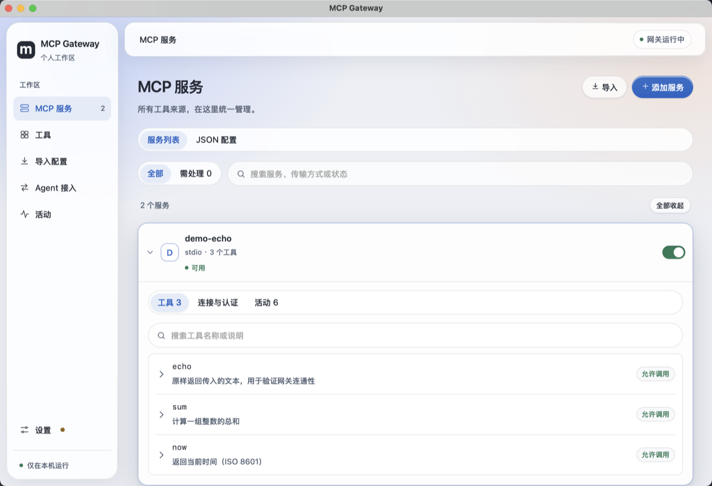
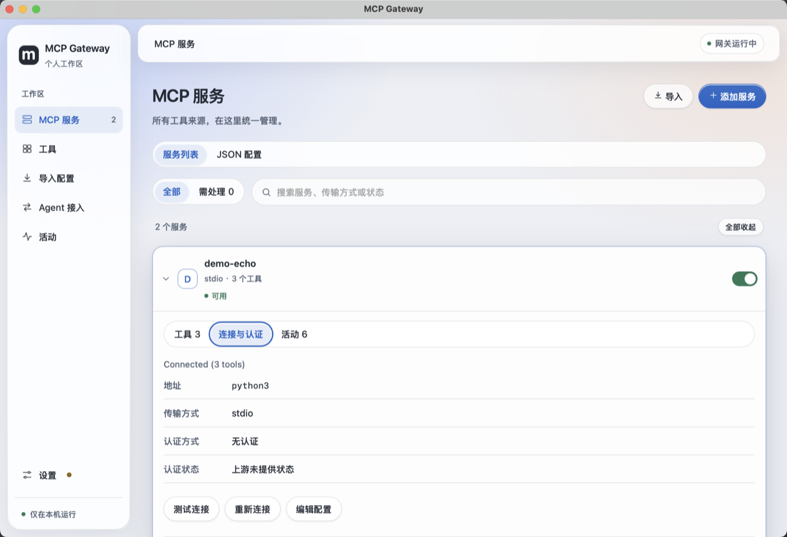
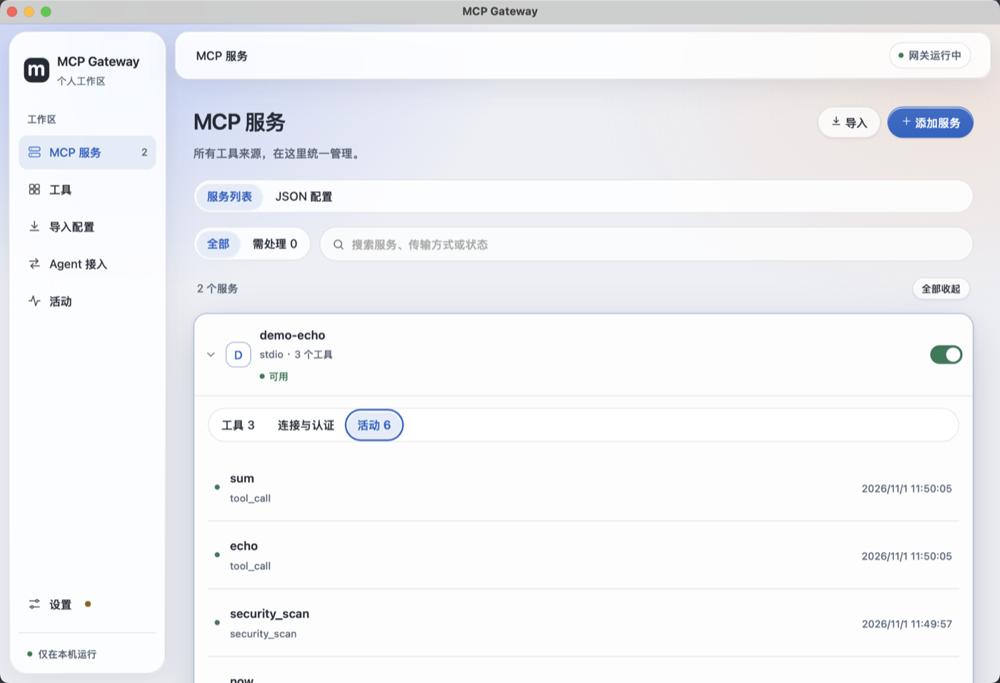
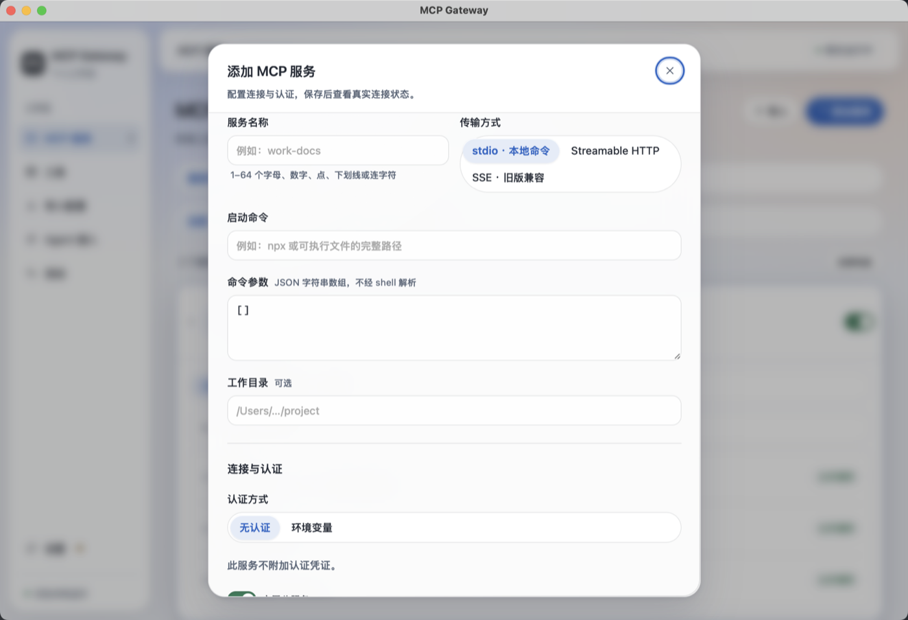
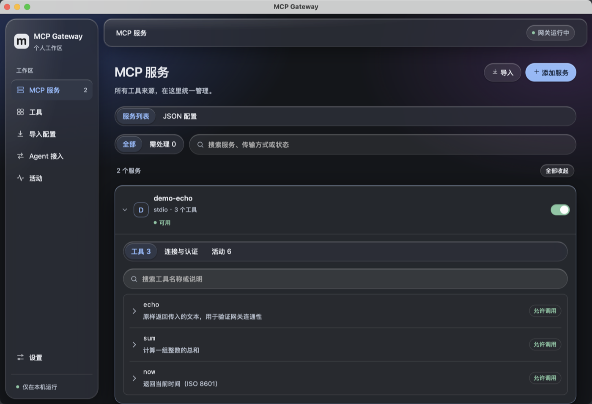

# MCP Gateway

个人 MCP 管理器，使用 Wails v3 + Vue 3，复用固定版本的 MCPProxy Go。提供服务和认证管理、工具目录与调用、配置导入/备份、五类客户端接入及原生菜单栏。macOS 与 Windows 共用同一套服务端与界面代码。

当前为开发中的本地应用，版本 `0.1.13`。受控协议和关键数据检查已取得结果，真实提供方、真实客户端和原生交互的完成情况以 [验收报告](docs/acceptance.md) 为准；未全部通过前不作为完成版本。

## 下载

从 GitHub Releases 下载对应平台的产物：

| 平台 | 产物 | 说明 |
| --- | --- | --- |
| macOS arm64 | `MCP-Gateway-0.1.13-arm64.dmg` | Apple Silicon / macOS 15 或以上；ad-hoc 签名，未公证 |
| Windows x64 | `MCP-Gateway-0.1.13-windows-amd64.zip` | Windows 10 1809+ / Windows 11；未签名，首次运行需通过 SmartScreen 确认 |

每个产物旁附 `.sha256` 校验文件。合入 `main` 后由 [Release workflow](.github/workflows/release.yml) 自动创建 `release/<version>` 分支、打 `v<version>` tag、构建上述两个产物并发布 Release。

## 界面



| | |
| --- | --- |
|  |  |
| 连接与认证：地址、传输、认证状态与三个操作 | 活动：本服务的真实调用记录 |
|  |  |
| 添加服务为模态表单，关闭前确认未保存修改 | 同一界面在深色主题下 |

截图来自本机打包后的应用，采集于 macOS 15 / Apple Silicon，使用隔离数据目录，`demo-echo` 是仓库内一个仅做本机回显的 stdio 服务；活动页两条记录是真实 `tool_call`，不是伪造数据。来源与复现方式见 [截图说明](docs/screenshots/README.md)。

界面采用 Liquid Glass 材质：侧栏、工具栏、对话框与提示条为半透明毛玻璃，卡片与按钮带细高光描边和柔和阴影。系统开启“减少透明度”“提高对比度”或不支持背景模糊时，自动回退为不透明填充，文字对比度始终满足 WCAG AA。

服务页每张卡片只有一个展开入口，面板内以分段切换三种内容：

- **工具**：分层工具目录，可搜索本服务的工具，展开查看参数 schema 并实际调用。
- **连接与认证**：地址、连接状态、错误详情、测试连接、重新连接、OAuth 登录/取消/刷新/清除，以及删除服务。
- **活动**：该服务最近的调用记录。

默认分段按状态选择：需登录或连接失败的服务直接停在“连接与认证”，其余停在“工具”。多个服务可同时展开，“全部收起”一次复位；服务筛选提供“全部 / 需处理”，计数随状态更新。需要处理时卡片头部直接给出“登录”“重新连接”或“编辑配置”，右侧开关立即启用或停用服务。

操作结果统一显示为右下角提示：成功提示 6 秒后自动消失（悬停或聚焦时暂停），错误提示保留到手动关闭。触发中的按钮显示进行中状态，其余控件暂时不可用；删除等不可逆操作在确认框内就地显示错误，不关闭对话框。

设置页在修改后显示“有未保存修改”、点亮保存按钮和导航圆点；“运行控制”（暂停新调用）独立成区，立即生效、不需要保存。

## 安装与升级

### 运行环境

- macOS：Apple Silicon，macOS 15 或以上。
- Windows：x64，Windows 10 1809 或以上 / Windows 11，需要系统自带或已安装的 WebView2 运行时。
- 应用自带网关核心，运行不需要 Go、Node.js 或开发服务器；stdio 上游自己声明的命令仍需在本机存在。

### 安装

1. 先从托盘/菜单栏退出正在运行的旧版本。替换文件前不退出，继续运行的是旧进程，界面上看不到新版本。
2. macOS：双击 DMG，把 `MCP Gateway.app` 拖到同窗口的 `Applications`，推出 DMG 后从「应用程序」打开。Windows：解压 zip 到固定目录（例如 `%LOCALAPPDATA%\Programs\MCP Gateway\`），运行 `mcp-gateway.exe`。
3. 首次运行提示未被验证/未签名时，按包内“安装与测试说明”允许这一个应用，不要关闭 Gatekeeper/SmartScreen 的全局保护。

### 升级

覆盖安装即可，无需卸载旧版本、也无需导出再导入配置。

- 更新检查与自动更新：应用启动时及之后每天向 GitHub Releases 查询一次最新版本（设置 → 关于 → “自动检查更新”可关闭，也可手动点“检查更新”）。发现新版本时设置导航出现提示点，点“更新到 X.Y.Z”并确认后：下载安装包到数据目录 `updates/`，用 Release 附带的 `.sha256` 校验，通过后应用先正常退出（进行中的调用先完成，网关随之停止），再由独立的辅助进程替换并重新打开。macOS 会校验新应用包签名，替换前旧应用保留，任何一步失败都恢复旧版本并重新打开，原因记在数据目录的 `update.log`；Windows 按同样方式替换安装目录内的文件。应用所在目录不可写（如装在需要管理员权限的位置）或不是从应用包运行时，不会替换，改为打开安装包让你手动安装。校验失败的文件会被丢弃。
- 数据目录不随安装包移动，也不在应用包内：macOS 为 `~/Library/Application Support/MCP Gateway/`，Windows 为 `%APPDATA%\MCP Gateway\`。
- 覆盖安装不会删除该目录中的 `settings.json`、`services.json`、`core.json`、`backups/`、日志与 `credentials/`（本机管理与客户端 token）。上游服务的凭证仍存放在系统凭证库中，不受影响。
- 升级后建议在 Agent 接入页重新预览并更新客户端配置，确认 `connect` 命令仍指向新应用的绝对路径；移动过应用位置时必须重新预览。
- 排错时先保留数据目录再重试，不要用删除配置的方式定位问题。

### 签名说明

两个平台均未做代码签名或公证：macOS 保留无需证书的本机 ad-hoc 签名，Windows 产物未签名。因此首次打开可能出现“无法验证开发者”（macOS）或 SmartScreen 提示（Windows）。这与应用内容无关，不能据此判断安装包损坏；校验值见 Release 附带的 `.sha256`。若提示已损坏或被检测为威胁，先反馈原文排查。

## 使用

1. 打开应用，在服务页添加 stdio、HTTP 或 SSE 服务，填写连接信息及认证。命令与工作目录建议使用绝对路径，避免图形界面启动与终端 PATH 不同。
2. 展开服务卡片，在“工具 / 连接与认证 / 活动”之间切换，按需测试连接、登录或调用工具。离线服务的目录标记为缓存或不可用。
3. 打开导入页时，应用会只读扫描 OMP、Claude Code、Cursor、CodeBuddy 和 Codex 的已知用户配置路径；选择检测到的来源后仍需预览、选择并确认，应用不会自动导入。也可手动选择或粘贴 JSON、JSONC、TOML。不同凭证、参数、环境变量和工作目录视为不同连接；应用自己生成的 `mcp-gateway connect` 客户端条目会被阻止，避免把网关接回自身。
4. 在 Agent 接入页选择 OMP、Claude Code、Cursor、CodeBuddy 或 Codex，预览目标配置变更后再写入。应用保留已有连接及无关配置，不会自动迁移全部客户端。网关入口下方的“网关工具与调用调试”默认收起，展开后可读取当前入口暴露的工具、查看参数定义并实际调用；收起保留本页参数与结果。
5. 渐进发现模式下 agent 只看到 `retrieve_tools`、`describe_tool`、`call_tool_*` 等 6 个入口工具，必须先检索再调用。使用引导页说明了这一变化，并提供可一键复制的 prompt 及各客户端全局规则文件的位置；加入规则后，后续会话会固定先经网关检索。prompt 中的参数名与内置网关核心一致，升级 MCPProxy 时需同步。

启动时显示管理窗口；关闭主窗口后网关继续在菜单栏/托盘运行，从这里可以重新打开。退出会先暂停新调用并等待已开始的调用结束，也可以选择立即停止。只管理本应用启动的核心和上游进程。

默认监听 `127.0.0.1:17840`。渐进模式使用 `/mcp/call`，普通聚合使用 `/mcp/all`。默认要求独立客户端凭证；设置中可允许本机无 Token 访问。管理接口使用另一套凭证。接入适配器写入随应用附带的 `connect` 命令，自动生成并复用本地客户端 token，每个连接进程持有独立的网关会话。

### 调用失败与诊断

命令查找会在保留现有 PATH 顺序的基础上补齐已发现的用户工具目录（如 `~/.local/bin`）。连接失败时显示中文提示，可展开「错误详情」查看未截断的脱敏错误。

首页先读取本地已保存的服务，连接状态和工具目录在后台更新；启动时不会先显示成空服务列表。状态为「等待连接状态」时不表示连接成功。

### 删除服务

在「连接与认证」分段底部点击「删除服务」。确认后会先备份网关配置，再删除服务；原始导入文件不受影响。

## 数据、认证与恢复

应用数据默认位于 `~/Library/Application Support/MCP Gateway/`（Windows 为 `%APPDATA%\MCP Gateway\`），包含 `settings.json`、`services.json`、`core.json`、加密 OAuth 数据和 `backups/`。目录限制为当前用户访问；本机管理与客户端 token 存放在 `credentials/`，目录权限 0700、文件权限 0600，不使用钥匙串；上游静态凭证继续使用系统凭证库（macOS 钥匙串 / Windows 凭据管理器）。普通配置使用凭证引用，诊断导出只包含允许的状态字段。

OAuth 支持开始登录、取消、刷新、重新登录和清除本地授权。清除本地授权不会替用户撤销提供方网站上的授权。受控 OAuth 测试与真实提供方实测分别记录。供应方要求的 Client ID 与 Scopes 在认证页填写。

保存服务、导入、写入客户端配置和恢复前创建备份。设置页的「配置备份」可恢复配置；恢复前会等待网关调用结束并再次备份当前状态。网关配置备份保留凭证引用，不包含系统凭证库的独立副本，因此复制备份到另一台机器后仍需重新填写凭证或登录。客户端原文件按原始字节备份，若原文件含内联凭证，备份也会保留；它受本机目录/文件权限保护，不属于可公开分享的脱敏导出。删除本地 OAuth 授权无法通过配置备份恢复。

监听端口冲突时不会连接或终止占用端口的其他进程。设置页可改用空闲的本机端口，然后重试启动；即使核心未能启动也可以修复监听配置。意外核心退出会显示错误，可从窗口或托盘重试。

日志保留天数在设置页配置；变更后会等待当前调用结束并重启核心，使新策略生效。活动记录在启动和定期清理时按时间删除；文件日志按 10 MB 轮转，保留天数约束归档文件，不逐行删除当前日志。诊断导出不会包含工具参数/结果、命令、连接 URL、Header、环境变量或 OAuth 凭证。当前开发版尚无本应用的更新源，检查更新会明确显示无法判断，而不会假报“已是最新”。

活动页的「导出诊断」会将 JSON 文件保存到应用数据目录下的 `diagnostics/`，显示完整路径并尝试打开该目录。文件名包含时间戳，文件仅当前用户可读写；可从这里取用或分享脱敏诊断。

## 本地构建

macOS 需要 Apple Silicon Mac、macOS 15 或以上、Xcode Command Line Tools、Go、Node.js/npm、Git 和 Python 3；Windows 需要 Go、Node.js/npm、Git、Python 3 与 zip。构建使用模块声明的 Go 工具链，不修改用户全局 Go 配置。

```sh
# macOS arm64：构建应用 + DMG
./scripts/build.sh
./scripts/package-dmg.sh
open 'bin/MCP-Gateway-0.1.13-arm64.dmg'

# Windows x64：构建应用 + zip（在 Windows 上运行）
./scripts/package-windows.sh
```

脚本固定 Wails `v3.0.0-beta.16`、MCPProxy `v0.65.0`（commit `308a81272844df896b616b886295305d97f90f8d`），应用 [核心补丁](patches/mcpproxy/)，生成前端绑定，执行检查，打包并做本机 ad-hoc 签名。`scripts/build-core.sh` 单独负责克隆固定版本核心、打补丁并编译，两个平台复用同一份源码与补丁。

`package-dmg.sh` 使用已构建的应用，通过系统 `hdiutil` 生成并校验压缩 DMG；`package-windows.sh` 交叉编译到 Windows 并打包为 zip。两者都旁置 `.sha256` 校验文件，只打包应用、安装指引和许可证，不包括开发环境或用户数据，也不执行安装。

### 版本号

`build/Info.plist` 的 `CFBundleShortVersionString` 是唯一来源，`frontend/package.json`、`frontend/package-lock.json` 与 `internal/gateway/manager.go` 的 `Version` 由脚本同步：

```sh
./scripts/version.sh read          # 读取当前版本
./scripts/version.sh set 0.1.13    # 同步写入以上各处
```

Release workflow 会先校验这几处一致，再以 `v<version>` 为 tag 发布；不一致时直接失败，不会发出版本号互相矛盾的产物。

版本与边界见 [核心集成说明](docs/core-integration.md)、[客户端适配说明](docs/client-adapters.md)。运行时不需要启动 npm/Vite，也不需要单独安装核心。

## 开发与验证

```sh
go test -race ./...
go vet ./...
npm --prefix frontend run build
npm --prefix frontend run check
npm --prefix frontend run typecheck
```

协议检查需要允许本机回环端口监听。`.cache/`、`bin/`、`artifacts/` 与前端生成文件不纳入源码版本管理。可用 `MCP_GATEWAY_DATA_DIR` 指定隔离测试数据目录，`MCP_GATEWAY_CORE` 指定明确的核心可执行文件；不会自动接管其他 MCPProxy 实例。

原生测试可临时使用 `-tags production,mcp` 构建，并通过 Wails 内置的本机 MCP 检查窗口和 DOM。交付构建只使用 `production`，不包含该测试控制接口。浏览器独立打开前端时没有桌面绑定，会明确显示未连接，不使用伪造数据。

项目范围、分工和全部待验收项见 [项目目标](docs/project-goal.md)、[实施记录](docs/execution-plan.md) 和 [验收报告](docs/acceptance.md)。安装与逐项实机验证步骤见 [macOS 说明](docs/install-and-verify.md)（包内同时附纯文本版）与 [Windows 说明](docs/install-and-verify-windows.txt)。
